# ResumeCraft

A resume and cover letter builder that keeps your documents in your own browser. Choose one of 12 layouts, write in English or Khmer, watch the pages update as you type, and save a PDF with selectable text. Optional Gemini features help with wording, and nothing they suggest is applied until you accept it.

[](https://nextjs.org)
[](https://react.dev)
[](https://www.typescriptlang.org)
[](https://tailwindcss.com)
[](https://ai.google.dev)
[](https://dexie.org)
[](https://vitest.dev)
[](https://playwright.dev)
[](https://pnpm.io)

**Live demo:** not deployed yet.

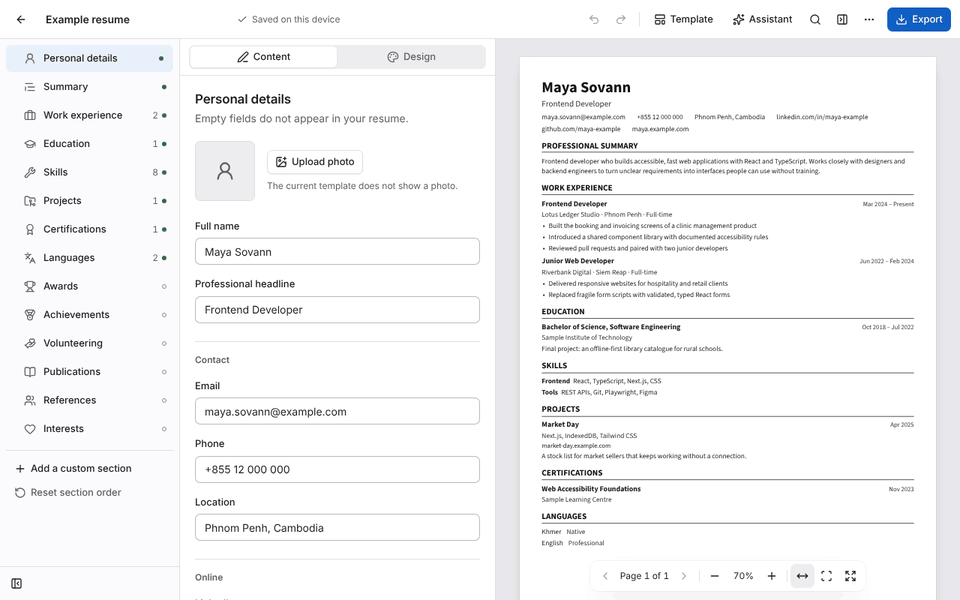

## Screenshots

Taken from the running app. All people, companies and schools shown are fictional. No Gemini key was set, so AI panels show their "not available" state and no AI output appears.


| Landing page                               | Template gallery                                    |
| ------------------------------------------ | --------------------------------------------------- |
| 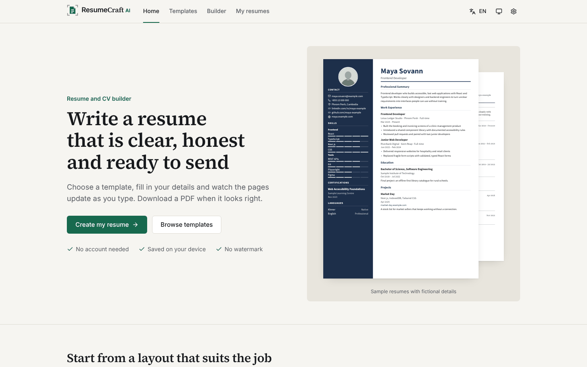 |  |

| My resumes                                      | Export                                        |
| ----------------------------------------------- | --------------------------------------------- |
| 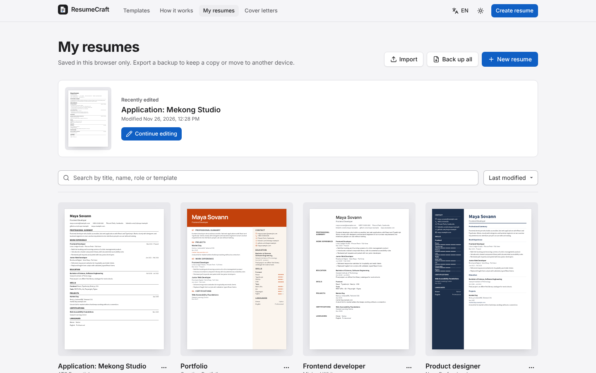 | 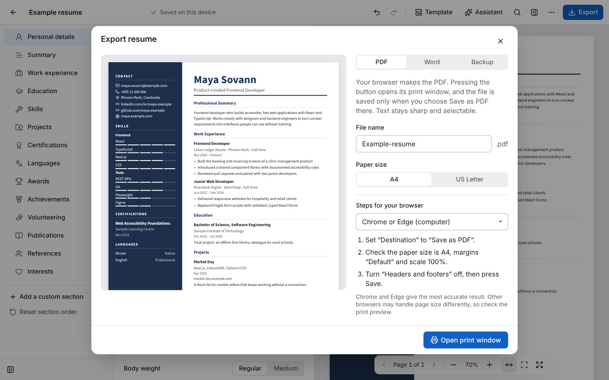 |

| Job matching in the assistant                                   | Compatibility check                                        |
| --------------------------------------------------------------- | ---------------------------------------------------------- |
| 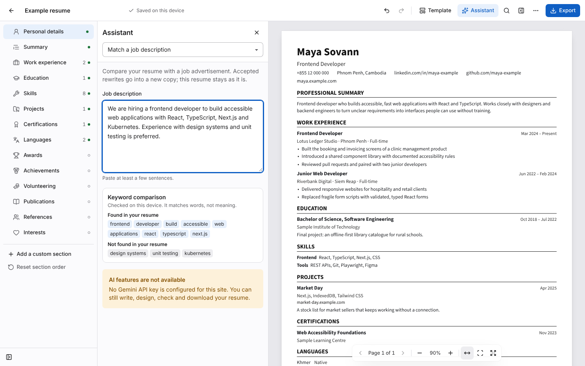 |  |

| Cover letters                                        | Dark theme (the resume keeps its own colours)             |
| ---------------------------------------------------- | --------------------------------------------------------- |
| 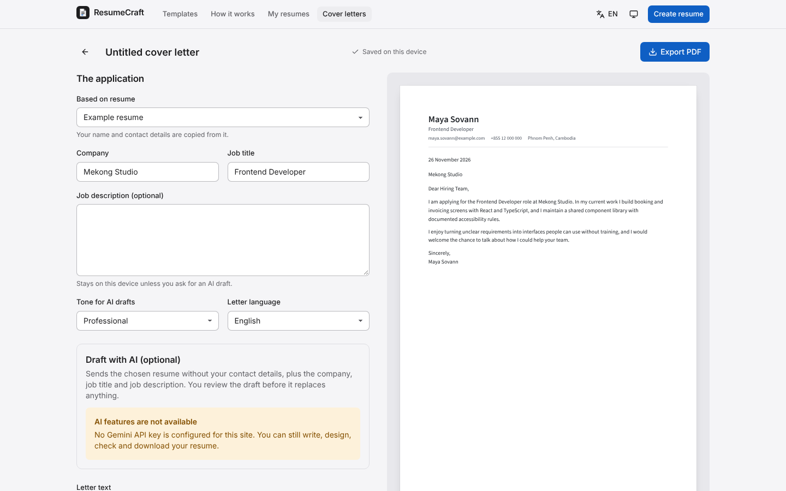 |  |

**Khmer interface and Khmer resume text:**

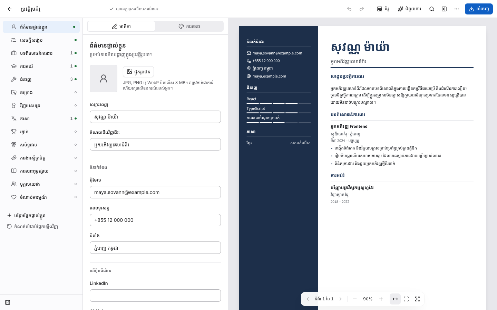

**On a phone** the editor becomes four views: Sections, Edit, Design and Preview.

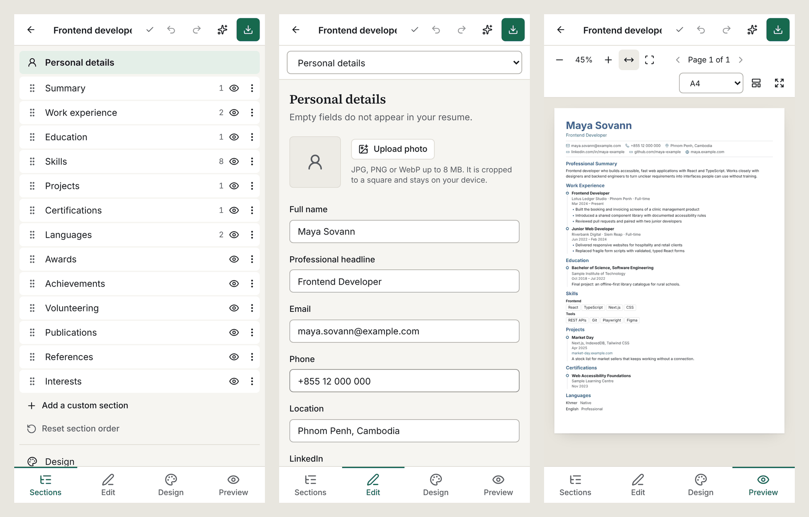

**Exported PDFs**, including Khmer:

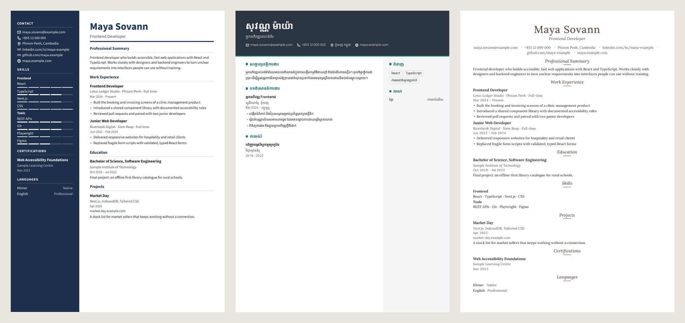

<details>
<summary><strong>Before and after the redesign</strong></summary>

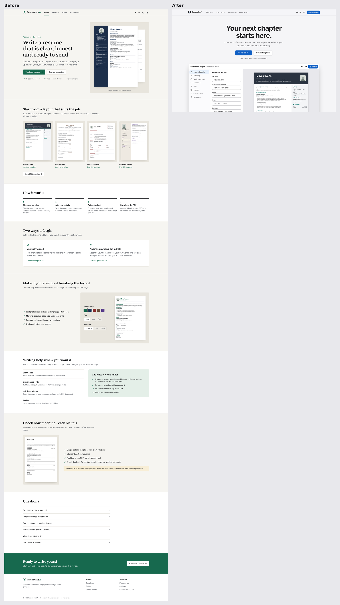
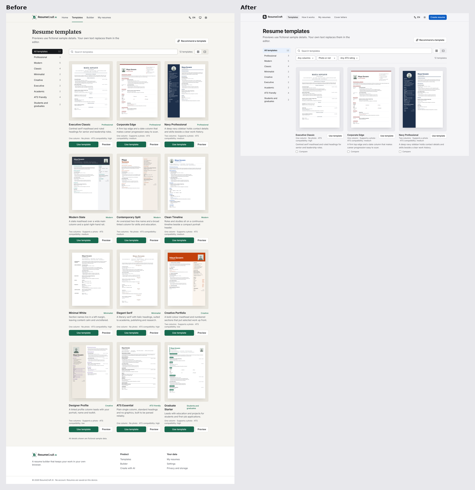


The audit behind the redesign is in [docs/redesign-audit.md](docs/redesign-audit.md).

</details>

## Features

**Writing and design**

- 12 templates with different layouts (one and two column, with and without photos)
- Sections for experience, education, skills, projects, certifications, languages, awards, achievements, volunteering, publications, references and interests, plus your own custom sections
- Drag, keyboard or button reordering; show and hide sections
- Colours, six font families, text sizes, spacing, margins, photo shape, A4 or US Letter
- Live preview with real page breaks, zoom and full-screen view
- Undo and redo, autosave, search across the editor, and keyboard shortcuts (press `?`)

**Bringing documents in and out**

- Import a PDF with selectable text, a Word `.docx` file or a ResumeCraft backup. You check every field before anything is saved. Scanned pages cannot be read.
- **PDF** made by your browser's print window ("Save as PDF"), with selectable text and working links
- **Word** file that downloads directly: editable, one column, same text, sections and links
- **Backup** file with your resumes, their version history and your cover letters, to keep or move to another device. Older backup files still import.

**Applications**

- Cover letters that copy your name and contact details from a resume, with live preview and PDF or editable Word export
- Job matching: compare a resume with an advert on your device, then (optionally) review suggested rewrites one by one and save them as a **new copy**
- A compatibility check that lists what to fix and takes you to the place. It works without AI.

**Your data**

- No account and no database: documents live in the browser (IndexedDB)
- A library with previews, search, sort, rename, duplicate and delete
- Version history for each resume, with preview and restore
- A reminder to download a backup, and one button that deletes all local data
- If two tabs edit the same document, you are asked which to keep instead of one silently overwriting the other

**Optional AI (needs a Gemini API key)**

- Questions and answers about resume writing, and template recommendations
- Summary options, rewrites of a single description, skill suggestions
- Resume review, job tailoring and cover letter drafts
- Guided creation: answer eight questions and check the draft before it becomes a resume
- Help sorting the text of an imported file into fields

**Also:** interface in English and Khmer (your resume text is never translated automatically), and light, dark and system themes.

## How it works, in plain words

The app is a website that does almost everything on your own device. Your browser reads imported files, draws the resume, saves it, and creates the PDF and Word files. A server is only involved when you ask for AI help: it holds the secret Gemini key, forwards the text that request needs, checks the answer, and sends it back.

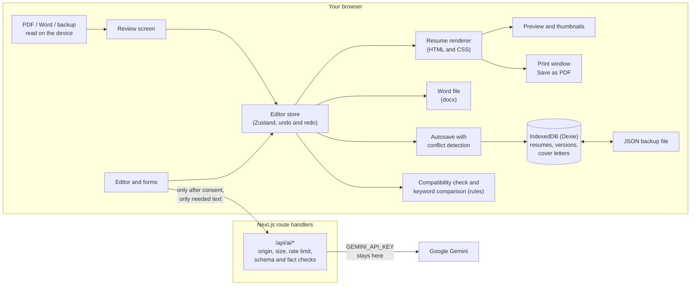

## Technology

| Area            | Choice                                                                            |
| --------------- | --------------------------------------------------------------------------------- |
| Framework       | Next.js 16 (App Router), React 19, TypeScript in strict mode                      |
| Interface       | Tailwind CSS 4, Radix UI primitives in a shadcn-style setup, Lucide icons, Motion |
| State and forms | Zustand, React Hook Form, Zod                                                     |
| Storage         | Dexie over IndexedDB                                                              |
| Reordering      | dnd-kit                                                                           |
| Languages       | next-intl (`en`, `km`)                                                            |
| Files           | pdf.js and mammoth to read, `docx` to write; each loaded only when needed         |
| AI              | `@google/genai` with structured JSON output                                       |
| Fonts           | Self-hosted Fontsource files, including Noto Sans and Serif Khmer                 |
| Quality         | ESLint, Prettier, Vitest, Playwright, axe-core                                    |

## Project structure

```text
src/
  app/            Pages (per language) and the AI route handlers
  components/     Layout, shared pieces and UI primitives
  constants/      Section definitions, design choices, fictional sample data
  features/
    ai-assistant/       Assistant drawer, job tailoring, checks, guided creation
    cover-letters/      Letter library, editor, preview and export
    customization/      Design panel and template picker
    import/             File import and review screens
    landing/            Landing page previews
    pdf-export/         Export window and print-based PDF
    resume-builder/     Editor, toolbar, preview, forms, versions
    resume-management/  Library, start page, settings, backups
    resume-templates/   Template registry, renderer and pagination
  lib/            AI server code, ATS rules, import, Word export, storage
  messages/       English and Khmer interface text
  stores/         Editor history and autosave
  types/          Data schemas (the single source of truth)
tests/            Unit tests (Vitest); tests/live calls the real Gemini API
e2e/              Browser tests (Playwright)
```

## Getting started

You need Node.js 22 or newer and pnpm 10.

```bash
pnpm install
cp .env.example .env.local   # optional, only for AI features
pnpm dev                     # http://localhost:3000
```

The app works fully without a Gemini key. AI screens then say that the features are unavailable.

## Setting up Gemini (optional)

1. Create an API key in [Google AI Studio](https://aistudio.google.com/).
2. Put it in `.env.local` as `GEMINI_API_KEY=...`.
3. Run `pnpm verify:ai`. It sends a few requests with invented text to Google and tells you whether the key and model work. It uses a little of your quota.
4. Restart the dev server.

Check the usage limits, price and data terms that apply to your key before you share a deployment. If your account does not offer the default model, set `GEMINI_MODEL` to one that supports structured output.

When something is wrong, the app says which kind of problem it is: no key, a rejected key, an unavailable model, a rate limit or used-up quota, a timeout, a network failure, or an answer that failed the checks. Running requests can be cancelled.

### Environment variables

All of them are read on the server only. Never add a `NEXT_PUBLIC_` prefix, and never commit `.env` or `.env.local`.

| Variable                 | Required                  | Default            | Purpose                                      |
| ------------------------ | ------------------------- | ------------------ | -------------------------------------------- |
| `GEMINI_API_KEY`         | For AI                    | empty              | Gemini key                                   |
| `GEMINI_MODEL`           | No                        | `gemini-3.8-flash` | Model name                                   |
| `AI_REQUESTS_PER_MINUTE` | No                        | `10`               | Per-address limit inside one server instance |
| `AI_RATE_LIMIT_ID`       | Recommended in production | empty              | ID of a Vercel Firewall rate-limit rule      |

## Commands

| Command                     | What it does                                  |
| --------------------------- | --------------------------------------------- |
| `pnpm dev`                  | Development server                            |
| `pnpm build` / `pnpm start` | Production build and server                   |
| `pnpm lint`                 | ESLint, with warnings treated as failures     |
| `pnpm typecheck`            | Route type generation and `tsc`               |
| `pnpm format`               | Prettier                                      |
| `pnpm test`                 | Unit tests                                    |
| `pnpm test:e2e`             | Browser tests (build first)                   |
| `pnpm verify:ai`            | Real Gemini requests with your key (optional) |
| `pnpm check`                | Lint, type check, unit tests and build        |

## Testing

**Unit tests** cover validation, editing, section ordering, template switching, undo and redo, autosave and conflicts, IndexedDB (including upgrading older data), backups, version history, cover letters, pagination, file import, Word export, AI request and response checks, tailoring, the compatibility rules, and matching English and Khmer messages.

**Browser tests** run against the production build and cover editing and persistence, templates, import, Word download, cover letters, versions, tailoring, photos, phone layouts, the Khmer interface, AI flows, automated accessibility checks (axe) in light and dark themes, and PDF export for all 12 templates (page count against the preview, blank pages, paper size, links, lost or repeated lines, embedded Khmer fonts).

Gemini is replaced by fixed answers in both suites. Neither needs a key or contacts Google.

```bash
pnpm exec playwright install chromium   # first time only
pnpm build
pnpm test:e2e
```

To use an installed Chrome instead, set `PLAYWRIGHT_CHROME_PATH` to its executable. Stop any server already running on port 3100, or the tests will use it. Exported test files are written to `test-results-pdf/` and `test-results-docx/`.

## Deploying to Vercel

1. Push the project to a Git repository and import it in Vercel. The framework is detected automatically.
2. For AI features, add `GEMINI_API_KEY` (and optionally `GEMINI_MODEL`) under the project's environment variables.
3. **Protect your key from abuse.** In the project's Firewall settings, create a custom rule that uses the `@vercel/firewall` rate-limit condition, choose an ID such as `ai-requests`, and set the limit you want. Publish it, then set `AI_RATE_LIMIT_ID` to that ID.
4. Deploy, then check on the live site: one AI feature, one PDF, one Word download and one file import. Check the browser console for blocked-content errors.

Without step 3 the only server limit is counted separately by each server instance (10 per minute and 100 per day per address), which slows bursts but is not a real quota. If the rule is configured but cannot be reached, requests are refused. A rule ID that does not exist only logs a warning, so check the logs after deploying. Also set a spending limit or quota on the Google side.

## Privacy and storage

| What                                                   | Where it is kept                   |
| ------------------------------------------------------ | ---------------------------------- |
| Resumes, photos, versions and cover letters            | IndexedDB in your browser          |
| Theme, panel width, AI consent, counters and reminders | `localStorage`                     |
| Interface language                                     | A cookie holding only `en` or `km` |

- There are no accounts, analytics or advertising trackers.
- Imported files are read inside your browser and are not uploaded.
- AI features need the internet. Before the first request the app explains what is sent and asks for permission, which you can withdraw in Settings.
- Resume text sent to the AI leaves out your name, email, phone, address, links, photo and references. Text you type into a question or a job description is sent as written. Contact details typed during guided creation and a cover letter's recipient name are not sent.
- Sorting an imported file with Gemini is a separate button. Your name, email addresses, phone numbers and links are removed first; **everything else in the document is sent**, and you can read exactly what before pressing it.
- The server does not store or log request content.
- Photos are cropped and re-encoded on your device, which removes metadata such as location.
- Clearing site data, using a private window or losing the device removes your documents. **Download a backup.** Backups include resumes, their version history (with earlier wording) and cover letters.

### AI safeguards

- Job descriptions, imported documents and resume text are passed to the model as data, with instructions not to follow anything inside them.
- Every request and response is checked against a schema.
- Rewrites, summaries and letters that introduce new numbers are rejected.
- Drafted or imported details that cannot be found in what you provided are removed, and you are told which.
- A requirement is shown as "met" only with evidence quoted from your resume.
- Suggestions show the original beside the new text and wait for you to accept, edit or reject them. Tailored text goes into a copy, so the original resume is not changed.

These checks reduce mistakes but cannot prove that a sentence is true. Read everything before you send it.

## Decisions and tradeoffs

**PDF through the browser's print engine.** An early test of `@react-pdf/renderer` 4.9.1 dropped final Khmer letters, let text overflow and produced garbled text on extraction. The app instead renders one HTML document for thumbnails, preview and export, and opens the print window. The result displays Khmer correctly, embeds its fonts, keeps text selectable and links working, and matches the preview. The cost is one extra step: you choose "Save as PDF".

**A plain Word file.** Copying each design into Word would be fragile and hard to edit. The Word export keeps the content and structure in one simple column.

**One renderer, block-based pages.** Content is split into small blocks, measured, and placed on fixed-size pages, so headings stay with their text. Very long paragraphs are divided so nothing is cut off.

**Local-first.** No backend to run and no personal data to protect on a server. The cost is no sync between devices.

**Facts are guarded by rules, not trust.** The strict checks can occasionally reject a harmless rewrite. Rejecting is safer than inventing an achievement.

**No folders or tags.** Search and sort cover a personal library without another thing to maintain.

## Known limitations

- Browser tests run in Chrome only. Firefox, Safari and real phones have not been verified. PDF export is most reliable in Chrome and Edge.
- The AI features have been tested with fixed stand-in answers only, not against the real Gemini API. Run `pnpm verify:ai` before relying on them.
- Khmer looks correct in the PDF, but copying or machine-reading it is unreliable: depending on the tool, characters come out reordered, spaced apart or missing. A hiring system may not read a Khmer PDF properly. The Word file keeps the text as typed.
- Importing is never perfect. Two-column layouts and Khmer PDFs often need corrections, and scanned documents are not supported. Older `.doc` files are not supported.
- Word files were checked with LibreOffice, not Microsoft Word. They use the "Khmer UI" font for Khmer, and WebP photos are left out.
- Version history is opened from the editor. A backup keeps up to 20 automatic and 30 named versions for each resume. Backup files up to 100 MB can be imported.
- The compatibility check is an estimate and cannot guarantee that any hiring system accepts a resume. Keyword matching compares words, not meaning, and Khmer word splitting depends on the browser.
- The Khmer interface text needs review by a fluent speaker before public release.
- The fact checks are mechanical. They cannot detect every exaggeration or invented claim.
- Built-in AI limits are per server instance unless the Vercel Firewall rule is set up.
- Data belongs to one browser. There is no sync.

## Roadmap

- Verify the AI features with a real key, then Firefox, Safari and real phones
- Review of the Khmer text by a fluent speaker
- Installable offline app (AI would still need a connection)
- Optional encrypted backup to the user's own cloud storage
