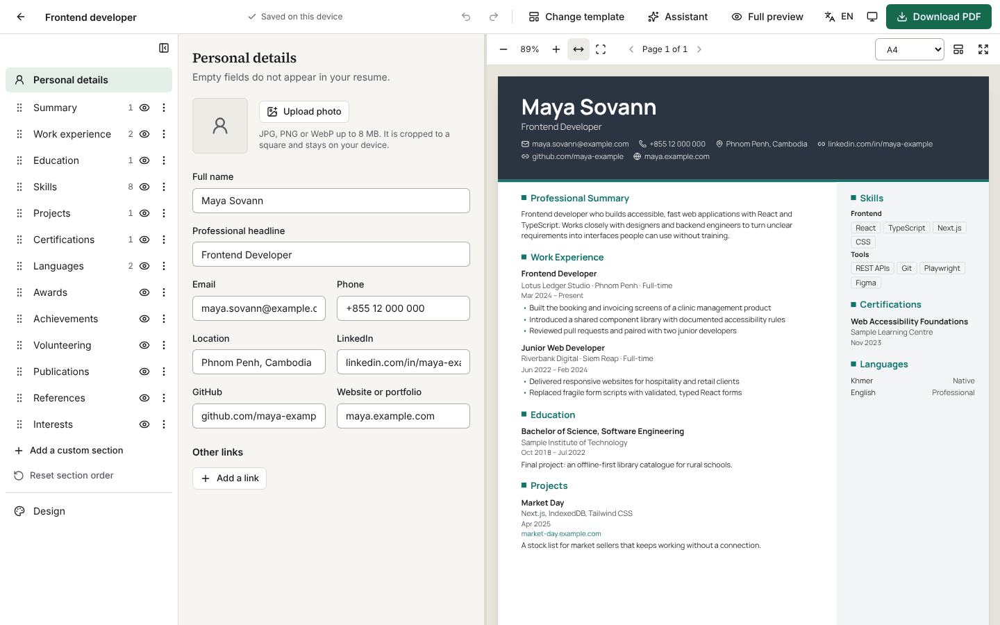
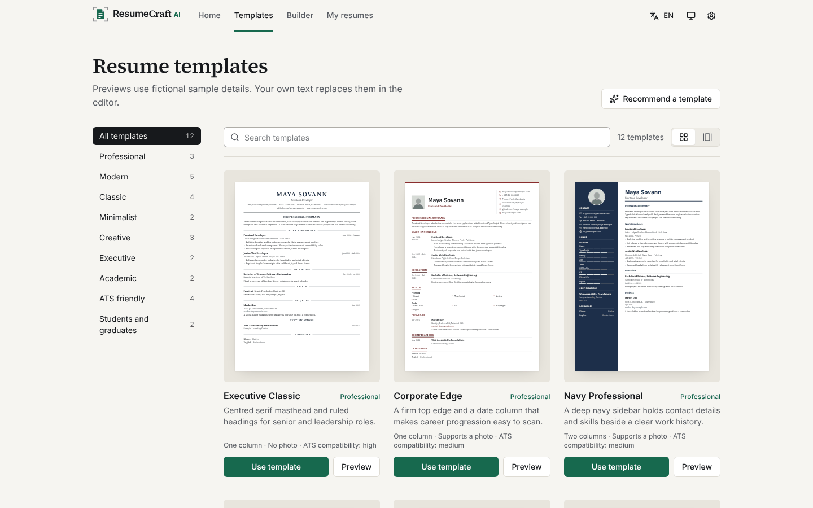
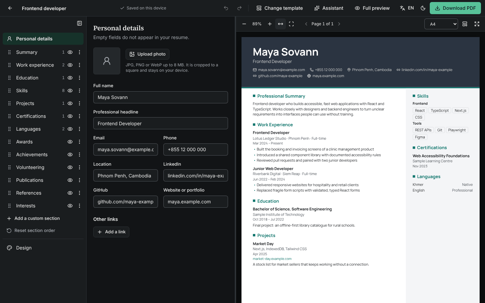
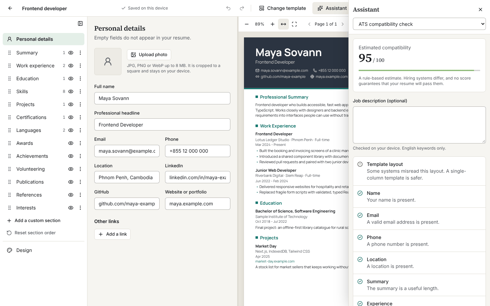
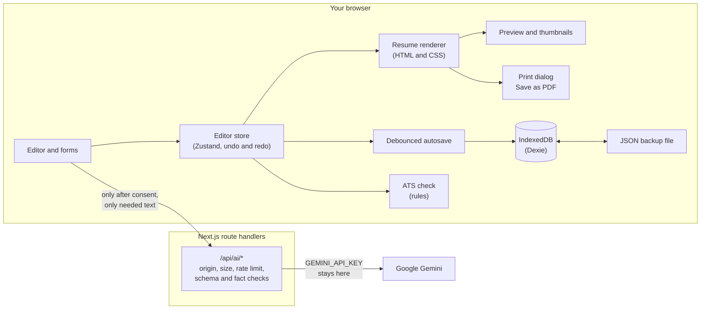

# ResumeCraft AI

A resume and CV builder that keeps your documents in your own browser. Choose one of 12 layouts, write in English or Khmer, watch the pages update as you type, and save a PDF with selectable text. Optional Gemini features help with wording, and nothing they suggest is applied until you accept it.

[](https://nextjs.org)
[](https://react.dev)
[](https://www.typescriptlang.org)
[](https://tailwindcss.com)
[](https://ai.google.dev)
[](https://zod.dev)
[](https://vitest.dev)
[](https://playwright.dev)
[](https://pnpm.io)

**Live demo:** not deployed yet.

## Screenshots

All people, companies and schools shown are fictional.



| Landing page                               | Template gallery                                    |
| ------------------------------------------ | --------------------------------------------------- |
|  |  |

| Dark theme (the resume keeps its own colours)             | Compatibility check                                        |
| --------------------------------------------------------- | ---------------------------------------------------------- |
|  |  |

**On a phone** the editor becomes four views: Sections, Edit, Design and Preview.


**Exported PDFs**, including Khmer:


## Features

**Writing and design**

- 12 templates with different layouts (one and two column, with and without photos)
- Sections for experience, education, skills, projects, certifications, languages, awards, achievements, volunteering, publications, references and interests, plus your own custom sections
- Drag, keyboard or button reordering; show and hide sections
- Colours, six font families, text sizes, spacing, margins, photo shape, A4 or US Letter
- Live preview with real page breaks, zoom and full-screen view
- Undo and redo, with autosave

**Your data**

- No account and no database: resumes live in the browser (IndexedDB)
- Duplicate, rename, search, sort and delete
- JSON backup export and import; importing never overwrites an existing resume
- One button deletes all local data

**Optional AI (needs a Gemini API key)**

- Questions and answers about resume writing
- Template recommendations
- Summary options, rewrites of a single description, skill suggestions
- Resume review and job description comparison
- Guided creation: answer eight questions and check the draft before it becomes a resume

**Also**

- A rule-based ATS compatibility check that works without AI. It is an estimate and cannot guarantee that any hiring system accepts a resume.
- Interface in English and Khmer. Resume text is never translated automatically.
- Light, dark and system themes

## How it works, in plain words

The app is a website that does almost everything on your own device. Your browser draws the resume, saves it, and creates the PDF. A server is only involved when you ask for AI help: it holds the secret Gemini key, forwards the text that request needs, checks the answer, and sends it back.



## Technology

| Area            | Choice                                                                            |
| --------------- | --------------------------------------------------------------------------------- |
| Framework       | Next.js 16 (App Router), React 19, TypeScript in strict mode                      |
| Interface       | Tailwind CSS 4, Radix UI primitives in a shadcn-style setup, Lucide icons, Motion |
| State and forms | Zustand, React Hook Form, Zod                                                     |
| Storage         | Dexie over IndexedDB                                                              |
| Reordering      | dnd-kit                                                                           |
| Languages       | next-intl (`en`, `km`)                                                            |
| AI              | `@google/genai` with structured JSON output                                       |
| Fonts           | Self-hosted Fontsource files, including Noto Sans and Serif Khmer                 |
| Quality         | ESLint, Prettier, Vitest, Playwright                                              |

## Project structure

```text
src/
  app/            Pages (per language) and the AI route handlers
  components/     Layout, shared pieces and UI primitives
  constants/      Section definitions, document labels, fictional sample data
  features/
    ai-assistant/       Assistant drawer, guided creation, consent
    customization/      Design panel and template picker
    landing/            Landing page previews
    pdf-export/         Print-based export
    resume-builder/     Editor, toolbar, preview and forms
    resume-management/  Library, start page, settings, backups
    resume-templates/   Template registry, renderer and pagination
  lib/            AI server code, ATS rules, storage, utilities
  messages/       English and Khmer interface text
  stores/         Editor history and autosave
  types/          The resume schema (single source of truth)
tests/            Unit tests (Vitest)
e2e/              Browser tests (Playwright)
```

## Getting started

You need Node.js 22 or newer and pnpm 10.

```bash
pnpm install
cp .env.example .env.local   # optional, only for AI features
pnpm dev                     # http://localhost:3000
```

The app works fully without a Gemini key. AI screens then say that the features are unavailable.

## Setting up Gemini (optional)

1. Create an API key in [Google AI Studio](https://aistudio.google.com/).
2. Put it in `.env.local` as `GEMINI_API_KEY=...`.
3. Restart the dev server.

Check the usage limits, price and data terms that apply to your key before you share a deployment. If your account does not offer the default model, set `GEMINI_MODEL` to one that supports structured output.

### Environment variables

All of them are read on the server only. Never add a `NEXT_PUBLIC_` prefix, and never commit `.env.local`.

| Variable                 | Required                  | Default            | Purpose                                      |
| ------------------------ | ------------------------- | ------------------ | -------------------------------------------- |
| `GEMINI_API_KEY`         | For AI                    | empty              | Gemini key                                   |
| `GEMINI_MODEL`           | No                        | `gemini-3.8-flash` | Model name                                   |
| `AI_REQUESTS_PER_MINUTE` | No                        | `10`               | Per-address limit inside one server instance |
| `AI_RATE_LIMIT_ID`       | Recommended in production | empty              | ID of a Vercel Firewall rate-limit rule      |

## Commands

| Command                     | What it does                              |
| --------------------------- | ----------------------------------------- |
| `pnpm dev`                  | Development server                        |
| `pnpm build` / `pnpm start` | Production build and server               |
| `pnpm lint`                 | ESLint, with warnings treated as failures |
| `pnpm typecheck`            | Route type generation and `tsc`           |
| `pnpm format`               | Prettier                                  |
| `pnpm test`                 | Unit tests                                |
| `pnpm test:e2e`             | Browser tests (build first)               |
| `pnpm check`                | Lint, type check, unit tests and build    |

## Testing

**Unit tests** cover validation, editing, section ordering, template switching, undo and redo, autosave, IndexedDB, backup import and export, pagination, AI request and response checks, the ATS rules, and matching English and Khmer messages.

**Browser tests** run against the production build and cover manual editing and persistence, template and section changes, backups, photos, phone layouts, the Khmer interface, every AI flow, and PDF export for all 12 templates (page count against the preview, blank pages, paper size, links, lost or repeated lines, embedded Khmer fonts).

Gemini is replaced by fixed answers in every test. No test needs a key or contacts Google.

```bash
pnpm exec playwright install chromium   # first time only
pnpm build
pnpm test:e2e
```

To use an installed Chrome instead, set `PLAYWRIGHT_CHROME_PATH` to its executable. Exported test PDFs are written to `test-results-pdf/` so you can look at them.

## Deploying to Vercel

1. Push the project to a Git repository and import it in Vercel. The framework is detected automatically.
2. For AI features, add `GEMINI_API_KEY` (and optionally `GEMINI_MODEL`) under the project's environment variables.
3. **Protect your key from abuse.** In the project's Firewall settings, create a custom rule that uses the `@vercel/firewall` rate-limit condition, choose an ID such as `ai-requests`, and set the limit you want. Publish it, then set `AI_RATE_LIMIT_ID` to that ID.
4. Deploy, then check one AI feature and one PDF download on the live site.

Without step 3 the only server limit is counted separately by each server instance (10 per minute and 100 per day per address), which slows bursts but is not a real quota. If the rule is configured but cannot be reached, requests are refused. Also set a spending limit or quota on the Google side.

## Privacy and storage

| What                                               | Where it is kept                   |
| -------------------------------------------------- | ---------------------------------- |
| Resumes and photos                                 | IndexedDB in your browser          |
| Theme, panel width, AI consent, a daily AI counter | `localStorage`                     |
| Interface language                                 | A cookie holding only `en` or `km` |

- There are no accounts, analytics or advertising trackers.
- AI features need the internet. Before the first request the app explains what is sent and asks for permission, which you can withdraw in Settings.
- Resume text sent to the AI leaves out your name, email, phone, address, links, photo and references. Text you type into a question or a job description is sent as written. Contact details entered during guided creation are not sent.
- The server does not store or log request content.
- Photos are cropped and re-encoded on your device, which removes metadata such as location.
- Clearing site data, using a private window or losing the device removes your resumes. **Export a backup.**

### AI safeguards

- Job descriptions and resume text are passed to the model as data, with instructions not to follow anything inside them.
- Every request and response is checked against a schema.
- Rewrites and summaries that introduce new numbers are rejected.
- Drafted employers, schools, skills and certificates that do not appear in your answers are removed, and you are told which.
- Suggestions show the original beside the new text and wait for you to accept, edit or reject them.

These checks reduce mistakes but cannot prove that a sentence is true. Read everything before you send it.

## Decisions and tradeoffs

**PDF through the browser's print engine.** I first tested `@react-pdf/renderer` 4.9.1. With Khmer it dropped final letters, let text overflow and produced garbled text on extraction. The app instead renders one HTML document for thumbnails, preview and export, and opens the print dialog. The result displays Khmer correctly, embeds its fonts, keeps text selectable and links working, and matches the preview. The cost is one extra step: you choose "Save as PDF".

**One renderer, block-based pages.** Content is split into small blocks, measured, and placed on fixed-size pages, so headings stay with their text. Very long paragraphs are divided so nothing is cut off.

**Local-first.** No backend to run and no personal data to protect on a server. The cost is no sync between devices.

**Numbers are guarded by rules, not trust.** The strict check can occasionally reject a harmless rewrite. Rejecting is safer than inventing an achievement.

## Known limitations

- PDF export is most reliable in Chrome and Edge. Safari and some mobile browsers handle paper size and margins differently.
- Khmer looks correct in the PDF, but copying or machine-reading it is unreliable: depending on the tool, characters come out reordered, spaced apart or missing. A hiring system may not read a Khmer PDF properly.
- The AI features have been tested with fixed stand-in answers only, not yet with a real Gemini key.
- The Khmer interface text needs review by a fluent speaker before public release.
- ATS keyword matching understands English only, and templates with two columns may be read incorrectly by some hiring systems.
- The fact checks look for new numbers and unknown names. They cannot detect every exaggeration.
- Built-in AI limits are per server instance unless the Vercel Firewall rule is set up.
- Data belongs to one browser. There is no sync.
- There is no Word (.docx) import or export.

## Roadmap

- Import from an existing PDF or Word file, with review before saving
- Cover letters that reuse the resume
- Khmer keyword matching in the compatibility check
- Installable offline app (AI would still need a connection)
- Optional encrypted backup to the user's own cloud storage
