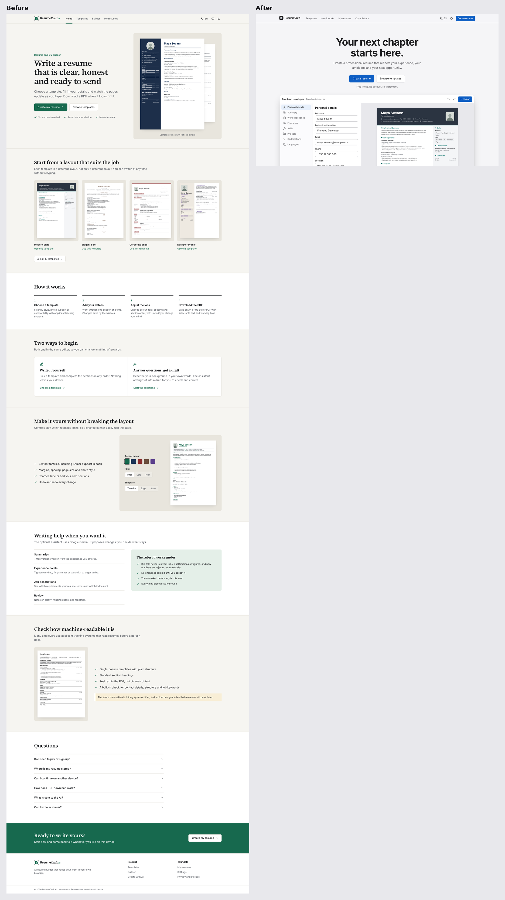
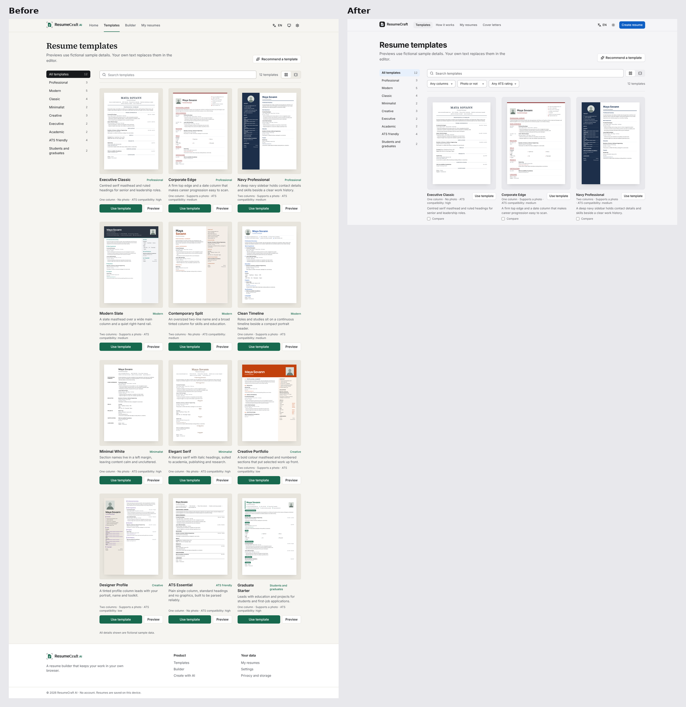
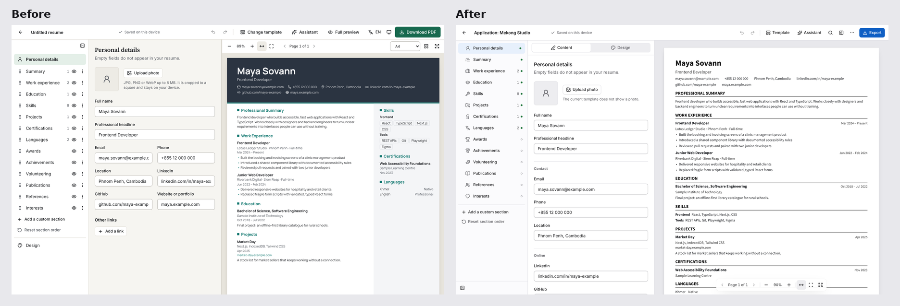
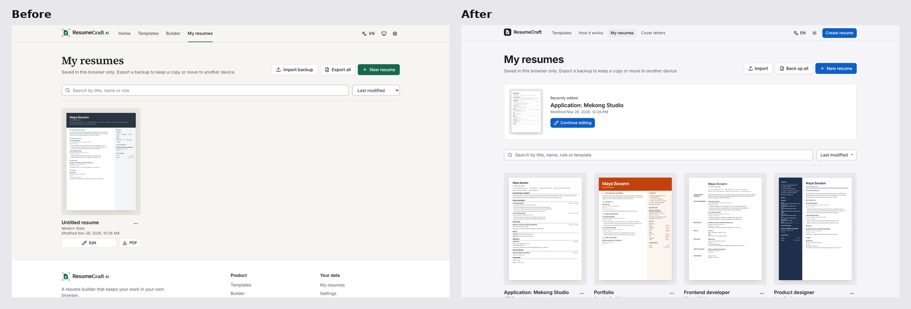
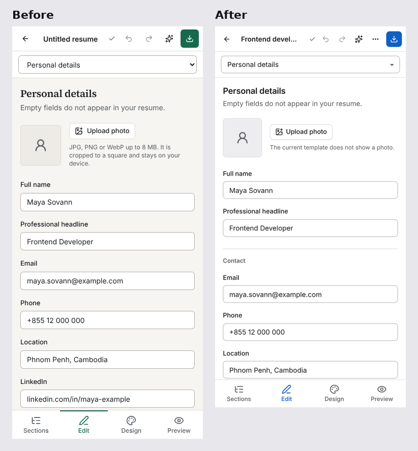

# Redesign and enhancement report

26 November 2026. Compared with commit `1a1d6cf`.

All four priorities are implemented. Some things could not be verified here (real Gemini calls,
Safari, Firefox, real phones, Microsoft Word and a live deployment); they are listed under
[Limitations](#limitations).

## Problems found in the previous version

From the [audit](redesign-audit.md), all addressed in this release:

| Area          | Problem                                                     | What changed                                                     |
| ------------- | ----------------------------------------------------------- | ---------------------------------------------------------------- |
| Editor        | Preview shrank to about 37% at 1024px                       | New panel layout with collapsible and resizable areas            |
| Editor        | Assistant covered the document                              | It sits beside the preview on wide screens                       |
| Editor        | Undo shortcut in assistant text boxes undid the resume      | Typing keeps its own undo                                        |
| Editor        | No completion state; crowded section rows                   | Compact rows, completion dots, actions on hover or focus         |
| Editor        | No theme or language choice on phones                       | Available from the editor menu                                   |
| Saving        | Two tabs overwrote each other; deleted resumes could return | Conflicts and deletions are detected and you choose              |
| Saving        | Failed saves waited for manual retry                        | Automatic retry and a way to download your text                  |
| Preview       | Pages measured twice per keystroke                          | Fonts are no longer re-checked on every change                   |
| AI            | Cancel did not stop the server request                      | Cancel button; the request is aborted on the server              |
| AI            | Different setup errors looked the same                      | Separate messages for key, model, quota, network and bad answers |
| ATS check     | Khmer ignored; aliases and phrases missed                   | Khmer word splitting, aliases and phrases                        |
| ATS check     | Large score implied false precision                         | Findings first, with "Go to it" buttons; score is secondary      |
| Templates     | Separator marks dangled where contact lines wrapped         | Spacing separates contacts                                       |
| Accessibility | Control names did not match visible text                    | Fixed; automated checks added                                    |

## Visual changes

- Visible name is now **ResumeCraft**, with a new logo.
- Neutral light theme and charcoal dark theme built on shared design tokens; one blue accent.
- Shorter landing page led by an editor preview with a real template.
- Template gallery centred on the documents, with filters, comparison and a preview window.
- Editor arranged as sections, inspector and document; four views on phones.
- Resume library as a document library with a "recently edited" item.

Before and after, from the running app (the library comparison uses different sample data):







## New features

- Import from PDF, Word (`.docx`) or backup, with review before a new resume is created
- Word export
- Cover letters with optional AI drafts, local saving and PDF export
- Job tailoring: on-device keyword comparison, reviewable rewrites, saved as a copy
- Version history with preview, restore and "open as new resume"
- Export window with file name, paper size, preview and per-browser steps
- Library search, sort, backup reminders
- Editor search, keyboard shortcuts, contextual writing actions beside text fields
- `pnpm verify:ai` to test a real Gemini key

Deliberately not added: folders or tags (search and sort cover a personal library).

## Existing data

Resumes made with the previous version open unchanged. This was checked by creating resumes in a
build of `1a1d6cf`, then opening the same browser profile in the new build: both opened and their
text and design settings were identical. The database upgrades from version 1 to 2 by adding tables
for versions and cover letters. The database name, backup format and settings keys are unchanged.
Your `interactive` option in the three template files is kept.

## Test results

| Check               | Result                                                                              |
| ------------------- | ----------------------------------------------------------------------------------- |
| `pnpm format:check` | Passed                                                                              |
| `pnpm lint`         | Passed, no warnings                                                                 |
| `pnpm typecheck`    | Passed                                                                              |
| `pnpm test`         | 117 passed (previously 58)                                                          |
| `pnpm build`        | Passed (clean build)                                                                |
| `pnpm test:e2e`     | 62 passed in Chrome (previously 40)                                                 |
| Accessibility (axe) | No violations on the pages and panels tested                                        |
| Layout              | No sideways scrolling or console errors in the audit at seven widths, 375 to 1920px |
| Script loading      | PDF and Word libraries were not downloaded by the landing or template pages         |
| `pnpm verify:ai`    | **Not verified**: skipped, because no key was available here                        |

Gemini is replaced by fixed answers in all automated tests.

## Limitations

- No real Gemini request was made. Whether the configured model works with your key is unverified;
  `gemini-3.8-flash` was only checked against Google's documentation.
- Firefox, Safari and real phones are untested.
- Word files were checked in LibreOffice, not Microsoft Word. WebP photos are left out of Word
  files. Cover letters export to PDF only.
- Khmer text extraction from PDF is unreliable, in both exported and imported files.
- Scanned PDFs and `.doc` files cannot be imported; imports need to be reviewed.
- Version history is not included in backups and is opened from the editor.
- AI fact checks are mechanical (numbers, quoted evidence, unknown terms) and cannot catch every
  invented claim.
- The compatibility check is an estimate and guarantees nothing about any hiring system.
- The Khmer interface text, including the new screens, needs review by a fluent speaker.
- Nothing is deployed, and the shared rate limit on Vercel is unverified.

## Deployment

1. Run `pnpm install` (new packages: `docx`, `mammoth`, and `axe-core` for tests; `pdfjs-dist` is
   now a runtime dependency).
2. Run `pnpm check`, then `pnpm verify:ai` with your key.
3. Commit and push, then import the repository in Vercel.
4. Set `GEMINI_API_KEY` and optionally `GEMINI_MODEL` in Vercel. Never use a `NEXT_PUBLIC_` prefix.
5. Create the Firewall rate-limit rule and set `AI_RATE_LIMIT_ID`; set a quota on the Google side.
6. On the live site, try one AI feature, a PDF, a Word download and an import, and check the browser
   console. Check the server log for a "rule was not found" warning.

Details are in the [README](../README.md#deploying-to-vercel).

## Changed files

65 new, 75 changed, 1 deleted.

```text
changed  .gitignore
changed  README.md
new      docs/redesign-audit.md
new      docs/release-report.md
new      docs/screenshots/assistant.png
changed  docs/screenshots/ats-check.png
new      docs/screenshots/before-after-editor.png
new      docs/screenshots/before-after-home.png
new      docs/screenshots/before-after-mobile.png
new      docs/screenshots/before-after-resumes.png
new      docs/screenshots/before-after-templates.png
new      docs/screenshots/demo.gif
changed  docs/screenshots/editor-dark.png
changed  docs/screenshots/editor.png
new      docs/screenshots/export.png
changed  docs/screenshots/home.png
new      docs/screenshots/khmer.png
new      docs/screenshots/letters.png
changed  docs/screenshots/mobile.png
changed  docs/screenshots/pdf-export.png
new      docs/screenshots/resumes.png
changed  docs/screenshots/templates.png
new      e2e/a11y.spec.ts
changed  e2e/app.spec.ts
changed  e2e/helpers.ts
new      e2e/import.spec.ts
new      e2e/letters.spec.ts
changed  e2e/pdf.spec.ts
new      e2e/tailor.spec.ts
new      e2e/versions.spec.ts
changed  eslint.config.mjs
changed  package.json
changed  pnpm-lock.yaml
new      src/app/[locale]/(site)/import/page.tsx
new      src/app/[locale]/(site)/letters/[id]/page.tsx
new      src/app/[locale]/(site)/letters/page.tsx
changed  src/app/[locale]/(site)/not-found.tsx
changed  src/app/[locale]/(site)/page.tsx
changed  src/app/[locale]/layout.tsx
changed  src/app/api/ai/[action]/route.ts
changed  src/app/globals.css
changed  src/app/icon.svg
changed  src/components/layout/logo.tsx
changed  src/components/layout/preferences.tsx
changed  src/components/layout/site-footer.tsx
changed  src/components/layout/site-header.tsx
changed  src/components/ui/button.tsx
changed  src/components/ui/field.tsx
changed  src/components/ui/overlays.tsx
new      src/constants/design.ts
changed  src/features/ai-assistant/ats-task.tsx
changed  src/features/ai-assistant/drawer.tsx
changed  src/features/ai-assistant/guided-creation.tsx
new      src/features/ai-assistant/inline-assist.tsx
changed  src/features/ai-assistant/parts.tsx
changed  src/features/ai-assistant/recommend-panel.tsx
new      src/features/ai-assistant/tailor-task.tsx
changed  src/features/ai-assistant/tasks.tsx
new      src/features/cover-letters/draft-panel.tsx
new      src/features/cover-letters/letter-document.tsx
new      src/features/cover-letters/letter-editor.tsx
new      src/features/cover-letters/letter-export.tsx
new      src/features/cover-letters/letter-library.tsx
new      src/features/cover-letters/letter-preview.tsx
changed  src/features/customization/design-panel.tsx
new      src/features/import/import-flow.tsx
new      src/features/import/review.tsx
new      src/features/landing/hero-window.tsx
changed  src/features/landing/previews.tsx
new      src/features/pdf-export/browser.ts
deleted  src/features/pdf-export/export-button.tsx
new      src/features/pdf-export/export-dialog.tsx
changed  src/features/pdf-export/print.tsx
new      src/features/pdf-export/use-export.tsx
changed  src/features/resume-builder/editor.tsx
changed  src/features/resume-builder/forms/entry-form.tsx
changed  src/features/resume-builder/forms/entry-list.tsx
changed  src/features/resume-builder/forms/inputs.tsx
changed  src/features/resume-builder/forms/personal-form.tsx
changed  src/features/resume-builder/forms/section-editor.tsx
changed  src/features/resume-builder/preview-pane.tsx
new      src/features/resume-builder/save-banner.tsx
new      src/features/resume-builder/search.tsx
new      src/features/resume-builder/section-meta.ts
changed  src/features/resume-builder/section-nav.tsx
new      src/features/resume-builder/shortcuts.tsx
changed  src/features/resume-builder/toolbar.tsx
new      src/features/resume-builder/version-dialog.tsx
new      src/features/resume-management/filter-resumes.ts
changed  src/features/resume-management/resume-library.tsx
changed  src/features/resume-management/settings-panel.tsx
changed  src/features/resume-management/start-panel.tsx
changed  src/features/resume-management/use-backup.tsx
changed  src/features/resume-management/use-create-resume.ts
changed  src/features/resume-templates/blocks.tsx
new      src/features/resume-templates/compare-dialog.tsx
new      src/features/resume-templates/filter.ts
changed  src/features/resume-templates/gallery.tsx
changed  src/features/resume-templates/preview-dialog.tsx
changed  src/features/resume-templates/resume-document.tsx
changed  src/features/resume-templates/rich-text.tsx
changed  src/features/resume-templates/scaled-pages.tsx
changed  src/features/resume-templates/templates.css
changed  src/lib/ai/guards.ts
changed  src/lib/ai/prompts.ts
changed  src/lib/ai/schemas.ts
changed  src/lib/ai/server.ts
new      src/lib/ai/tailor.ts
changed  src/lib/ats/analyze.ts
new      src/lib/ats/keywords.ts
new      src/lib/docx/build.ts
new      src/lib/import/extract.ts
new      src/lib/import/parse.ts
new      src/lib/import/redact.ts
new      src/lib/import/to-data.ts
new      src/lib/import/types.ts
changed  src/lib/resume-factory.ts
new      src/lib/storage/backup-reminder.ts
changed  src/lib/storage/backup.ts
changed  src/lib/storage/db.ts
new      src/lib/storage/letters.ts
new      src/lib/storage/versions.ts
changed  src/lib/utils.ts
changed  src/messages/en.json
changed  src/messages/km.json
changed  src/stores/autosave.ts
changed  src/stores/editor-store.ts
new      src/stores/editor-ui.ts
new      src/stores/letter-store.ts
new      src/types/cover-letter.ts
new      src/types/version.ts
changed  tests/ai.test.ts
changed  tests/ats-and-messages.test.ts
new      tests/docx.test.ts
changed  tests/editor.test.ts
new      tests/export.test.ts
new      tests/import.test.ts
new      tests/live/gemini.live.ts
changed  tests/storage.test.ts
new      tests/upgrade.test.ts
new      vitest.live.config.mts
```
